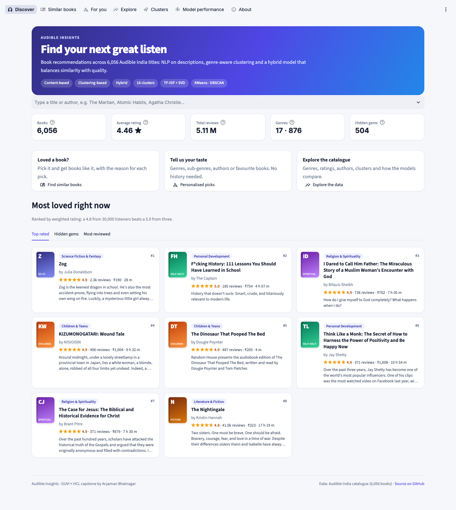
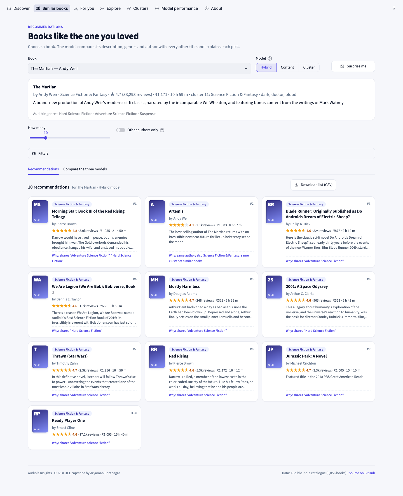
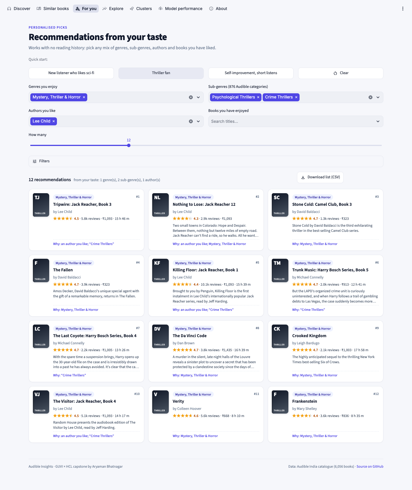
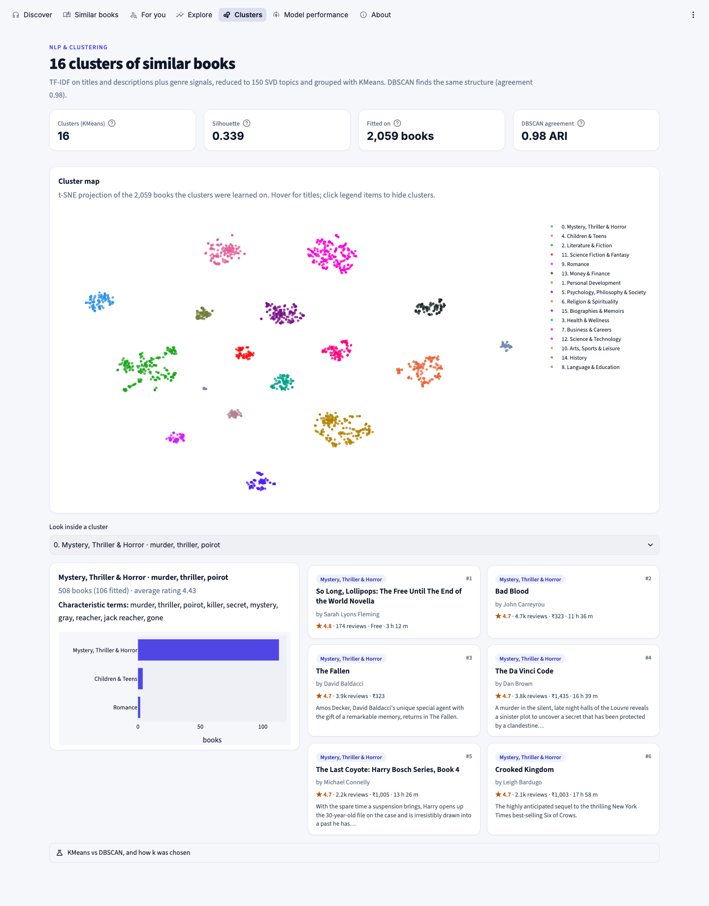
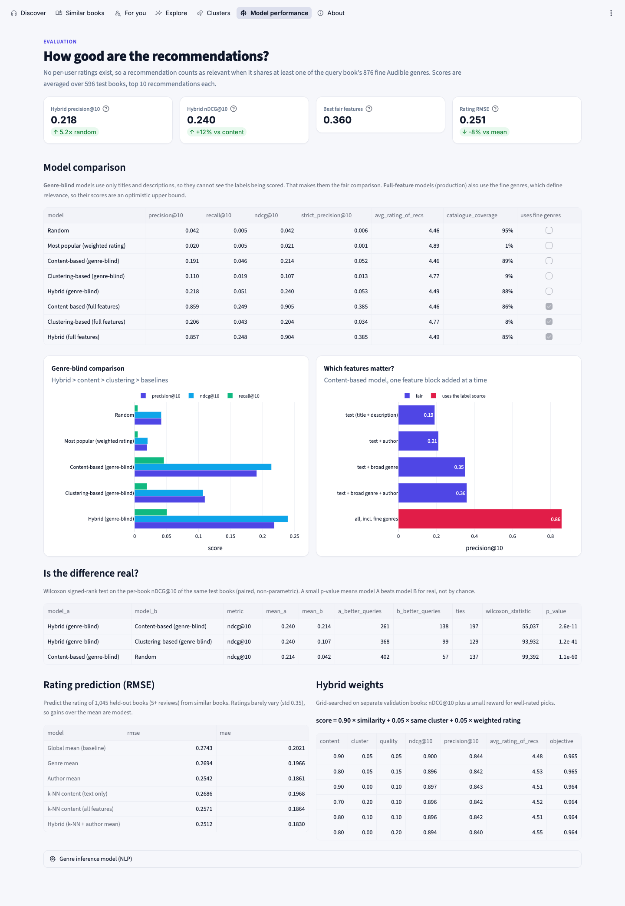

# Audible Insights: Intelligent Book Recommendations

**A book recommendation system for 6,056 Audible India titles.** It cleans and merges two scraped catalogues, uses
NLP on book descriptions, groups books into 16 clusters, and compares three recommenders: content-based,
clustering-based and hybrid. Everything is served through a Streamlit app, deployed on Streamlit Community Cloud
and AWS EC2 (Docker).


[](https://audible-insights.streamlit.app)

### 🔗 Live app: **[audible-insights.streamlit.app](https://audible-insights.streamlit.app)** · AWS EC2 (Docker): **[13.201.229.82](http://13.201.229.82)**



| What | Result |
|---|---|
| Data | 10,832 raw rows → **6,056 unique books**. 2,022 junk descriptions removed, 132 mis-scaled prices fixed, 876 fine genres mapped to 17 broad genres |
| NLP | TF-IDF (1–2-grams) on title + description. A genre classifier fills in genres for 218 books (CV accuracy 52% over 17 classes, 70% on the predictions kept) |
| Clustering | KMeans **k = 16** (silhouette 0.339). DBSCAN reproduces the same clusters (adjusted Rand index **0.98**) |
| Best recommender | **Hybrid**: as accurate as content-based without genre labels (precision@10 **0.194**, 4.6× random; nDCG@10 **0.216**) but recommends significantly better-rated books. Best fair feature set (text + genre + author): precision@10 **0.360** |
| Rating prediction | k-NN + author mean: RMSE **0.251** vs 0.274 for the global mean (−8%) |
| Significance | Wilcoxon signed-rank: hybrid vs content accuracy not different (p = 0.69); hybrid's picks rated higher on 377 vs 185 test books (p < 0.001) |
| Quality checks | 172-check end-to-end browser test of every page and control (`tests/e2e_app.py`); pipeline is byte-for-byte reproducible |

- **App:** seven pages: Discover, Similar books, For you, Explore, Clusters, Model performance, About. Features:
  - search from the home page straight into recommendations, or "Surprise me";
  - choose the model, and compare the three side by side;
  - every pick explains why it was chosen (shared sub-genres, same author, same cluster);
  - filters for genre, rating, reviews, price, length and hidden gems;
  - quick-start taste presets, and a CSV download of any list.
- **EDA:** [`notebooks/eda.ipynb`](notebooks/eda.ipynb) (executed) answers every question in the brief
- **Report:** [`reports/Audible_Insights_Report.pdf`](reports/Audible_Insights_Report.pdf)
- **AWS guide:** [`deploy/AWS_DEPLOY.md`](deploy/AWS_DEPLOY.md)

## Screenshots
| Similar books, with a reason for every pick | Personalised picks from your taste |
|---|---|
|  |  |
| **Clusters: 16 groups of similar books** | **Model performance: honest, genre-blind evaluation** |
|  |  |

---

## Business use cases
- **Personalised listening.** "Similar books" explains every pick (shared genres, same author, same cluster). "For
  you" works with no history at all: choose genres, sub-genres, authors or liked books.
- **Libraries and bookstores.** Top-rated and most-reviewed shelves, per-genre rankings, and a "hidden gems" filter
  for highly rated, little-known titles to promote.
- **Authors and publishers.** The Explore page shows which genres have the most titles versus the most listeners
  (sci-fi has 8× the reviews per title of business books), how ratings behave, and what pricing looks like.
- **Engagement.** Trending, top-rated and hidden-gem shelves on the home page.

## Run it locally
```bash
python -m venv .venv && source .venv/bin/activate      # Windows: .venv\Scripts\activate
pip install -r requirements.txt

python pipeline.py          # 1. clean + merge + infer genres        -> data/processed/
python train.py             # 2. features, clusters, models, evaluation -> models/   (~15 s)
streamlit run app/streamlit_app.py                     # the app on http://localhost:8501
```
The repo already contains the processed data and the trained models, so the app works right after
`pip install`. Every step uses fixed seeds, so re-running reproduces the same numbers.

## Project structure
| Path | Purpose |
|---|---|
| `config.py` | Every path, cleaning rule, genre-mapping rule and model setting, in one place |
| `pipeline.py` | Raw CSVs → `data/processed/books_clean.csv` + `cleaning_report.json` |
| `train.py` | Feature blocks, clustering, hybrid tuning, model comparison, feature ablation, RMSE → `models/` |
| `src/cleaning.py` | Parsing, junk-description detection, de-duplication, fuzzy author matching, merge, genre mapping, price fix |
| `src/nlp.py` | Text preparation, TF-IDF, the genre-inference classifier |
| `src/recommenders.py` | Feature blocks, two-stage clustering (KMeans + DBSCAN), content / cluster / hybrid recommenders |
| `src/evaluation.py` | Precision / recall / nDCG@k, feature ablation, hybrid-weight tuning, rating prediction |
| `src/eda.py` | One function per EDA question plus every static chart |
| `notebooks/eda.ipynb` | The EDA, executed, with written answers |
| `app/` | Streamlit app (`streamlit_app.py` entry, `views.py` pages, `data.py` data access, `ui.py` styling) |
| `models/` | `recommender.joblib`, `genre_classifier.joblib`, `model_metrics.json`, `cluster_summary.json` |
| `Dockerfile`, `deploy/` | Container image, EC2 start-up script, update script, AWS guide |
| `reports/` | PDF report, figures, app screenshots, and the scripts that build them |
| `tests/e2e_app.py` | End-to-end browser test: every button, tab, dropdown, slider, toggle and expander on every page |

## Methodology

### 1. Data preparation and cleaning (`src/cleaning.py`)
| Problem found | Count | How it was handled |
|---|---|---|
| Exact duplicate rows | 929 (basic) + 234 (advanced) | dropped |
| Same book scraped twice with different values | 266 | kept the most complete copy (real description > genres > listening time), then the most reviewed |
| Same title, author spelled differently ("Herman / Hermann Hesse") | 3 | fuzzy author match (≥ 0.85) unifies them before merging |
| Rating `-1` (always with a missing review count) | 631 + 421 | marked *unrated* (rating NaN, 0 reviews), never averaged in |
| "Descriptions" that are scraping failures: CAPTCHA pages (1,093), Amazon "rush hour" errors (628), checkout text, publisher stubs, award one-liners | 2,022 | treated as missing. Award lines are removed only when almost no content words remain |
| Ranks & Genre / listening time missing (blocked scrape) | 2,268 / 2,271 | left missing. Genre inferred from the description where confident |
| Prices 10× too high (dropped decimal: "A Game of Thrones" ₹18,149) | 132 | divided by 10 and flagged. Evidence: same length as other books but 14× the price per hour; corrected, ₹128/h, in line with the catalogue |
| `Ranks and Genre` is one string | n/a | parsed into the overall Audible rank plus a list of (rank, fine genre); split on `,#` because genre names contain commas |
| 876 fine genres | n/a | mapped to 17 broad genres by ordered keyword rules (`config.GENRE_RULES`), audited until no genre was unmapped |

The **merge** is an outer join on normalised title + author. The advanced file wins where both have a value: it is
the later scrape, and its review counts are higher for the same book. The result is 6,056 books: 3,347 in both
files, 2,049 only in the basic catalogue, 660 only in the advanced one.

Derived fields:
- **Bayesian weighted rating** (m = 50 reviews), so a 5.0 from 3 reviews doesn't outrank a 4.8 from 30,000.
- **popularity** (log reviews).
- **hidden gem** flag: rating ≥ 4.5, 5–65 reviews.
- listening minutes and a short title.

### 2. NLP (`src/nlp.py`)
- Text = title (twice) + cleaned description. TF-IDF with 1–2-grams, sublinear tf, and English plus domain stop
  words (audiobook vocabulary, "Penguin presents", "Audie award"…), giving 12.8k terms.
- **Genre inference.** Logistic regression on TF-IDF, trained on 1,821 books with known genres. 5-fold CV accuracy
  is 52% across 17 classes (top-3: 75%). The confidence cut-off is chosen on CV so that the predictions kept are
  right 70% of the time. That filled in 218 of 477 books that had a description but no genre; the rest stay
  *Unknown*.

### 3. Clustering (`src/recommenders.py`)
- Feature space: TF-IDF text plus broad- and fine-genre blocks, reduced with **TruncatedSVD (150 topics)**.
- **Two stages.** Clusters are learned on the 2,059 books with listed genres. Every other book joins the nearest
  cluster centroid in a text-only SVD space. Clustering everything at once left the genre-less books in one leftover
  cluster.
- **KMeans**: k = 16 chosen by silhouette over 8–30 (0.339). Each cluster is named by its dominant genre and its
  most characteristic terms, e.g. *Mystery, Thriller & Horror · murder, thriller, poirot*.
- **DBSCAN** comparison over eps 0.3–1.0. It is very sensitive to eps (97% noise at 0.3, one giant cluster at
  1.0). At eps 0.8–0.9 it finds the same clusters as KMeans (**ARI 0.98**), which independently confirms the
  structure.

### 4. Recommendation models
| Model | How it scores a candidate |
|---|---|
| **Content-based** | cosine similarity over weighted blocks: text 1.0, broad genre 0.6, fine genres 0.6, author 0.3 |
| **Clustering-based** | books in the query's cluster, ranked by weighted rating. Books placed in a cluster from their title alone are down-weighted |
| **Hybrid** | `0.9 × similarity + 0.05 × same cluster + 0.05 × weighted rating`. Weights are grid-searched on *validation* queries for nDCG@10, plus a small reward for well-rated picks |

Preference / cold-start queries ("For you") seed the profile with the best-rated books matching the chosen
genres, sub-genres and authors, then rank with the hybrid score.

### 5. Evaluation (`src/evaluation.py`, `train.py`)
The data has **no per-user ratings**, so the system can't measure "did this user like it". Instead, a
recommendation counts as **relevant** when it shares at least one of the query book's 876 fine Audible genres
(*strictly relevant*: two). The test set is 596 books, scored on the top 10 recommendations. The hybrid weights
were tuned on 300 separate validation books that never appear in the test set.

| Model (genre-blind: text only) | precision@10 | recall@10 | nDCG@10 | avg rating of recs | coverage |
|---|---|---|---|---|---|
| Random | 0.042 | 0.005 | 0.042 | 4.46 | 95% |
| Most popular | 0.020 | 0.005 | 0.021 | 4.89 | 1% |
| Content-based | 0.191 | 0.046 | 0.214 | 4.46 | 89% |
| Clustering-based | 0.073 | 0.016 | 0.077 | 4.77 | 9% |
| **Hybrid** | **0.194** | **0.045** | **0.216** | **4.50** | 88% |

"Genre-blind" models use only titles and descriptions, so they can't see the labels being scored. The production
(full-feature) versions also use the fine genres; they score 0.86 precision@10, an optimistic upper bound because
those genres define relevance.

**Feature ablation** (content-based model, which combination is most accurate):

| features | precision@10 | nDCG@10 |
|---|---|---|
| text (title + description) | 0.191 | 0.214 |
| + author | 0.210 | 0.239 |
| + broad genre | 0.350 | 0.364 |
| **+ broad genre + author** | **0.360** | **0.382** |

In the genre-blind test the clustering-based and hybrid models use clusters learned from description text alone. The
production clusters use genre features, and evaluating with them would leak the labels being scored. With those
leaky clusters the hybrid appeared to beat content-based on accuracy; with text-only clusters it does not.

**Are the differences real?** Two-sided Wilcoxon signed-rank tests on the same 596 test books (paired and
non-parametric, because per-book scores are bounded and far from normal):

| comparison | metric | A better / B better / ties | p-value |
|---|---|---|---|
| Hybrid vs content-based | nDCG@10 | 204 / 196 / 196 | 0.69 (no difference) |
| Hybrid vs content-based | avg rating of picks | 377 / 185 / 34 | < 0.001 |
| Hybrid vs clustering-based | nDCG@10 | 361 / 97 / 138 | < 0.001 |
| Content-based vs random | nDCG@10 | 402 / 57 / 137 | < 0.001 |

**Final model: the hybrid.** It's as accurate as pure content-based and recommends significantly better-rated books.

**Rating prediction** (1,045 held-out books with 5+ reviews):

| model | RMSE | MAE |
|---|---|---|
| global mean (baseline) | 0.274 | 0.202 |
| genre mean | 0.269 | 0.197 |
| author mean | 0.254 | 0.186 |
| k-NN content (all features) | 0.257 | 0.187 |
| **hybrid (k-NN + author mean)** | **0.251** | **0.183** |

## Key EDA findings
Full answers, with charts, are in [`notebooks/eda.ipynb`](notebooks/eda.ipynb).
- **Genres.** Literature & Fiction, Business and Personal Development have the most titles. Fiction, Children's and
  Thrillers get the most listeners. Sci-fi & fantasy has 1,412 median reviews per title, about 8× business.
- **Top-rated books** (weighted rating, 100+ reviews): *High Achiever*, *Awaking Wonder*, *Relationship Goals*,
  *Zog*; the *Wings of Fire* series holds six of the top 15.
- **Most common authors:** Harvard Business Review and OSHO (32 titles each), Devdutt Pattanaik (29), Ruskin Bond (28).
- **Top authors** (3+ books, each with 20+ reviews): Tracey West 4.87, Tui T. Sutherland 4.86, then Joyce Meyer,
  Bill Johnson and Watchman Nee (4.80). Julia Donaldson has 13 books at 4.77 with 30k reviews.
- **Ratings are compressed.** Mean 4.46, 61% at 4.5+, 5.6% below 4.0. Books with under 10 reviews are 33% perfect
  5.0s, so raw stars mislead.
- **Popularity ≠ quality.** Down the Audible rank, reviews fall 13× while ratings barely move. Author popularity
  helps only slightly (ρ = 0.09).
- **Price tracks length** (ρ = 0.66), not rating. History is the longest and dearest genre (16.7 h, ₹1,003);
  25% of language courses are free.
- **Statistical tests** (non-parametric, because ratings are skewed): ratings differ by genre (Kruskal–Wallis,
  p ≈ 10⁻³⁷); books with 1,000+ reviews rate higher than books with under 50 (Mann–Whitney, p ≈ 10⁻¹⁹); free titles
  depend on genre (chi-square, p ≈ 10⁻²⁸).
- **Publication-year trends can't be answered**: neither file has a date (only 17 descriptions state one).
- **Scenarios:**
  - New sci-fi fan → *Morning Star*, *So Long, Lollipops*, *The Martian*, *Jurassic Park*, *Thrawn*.
  - Thriller lover → Reacher, Baldacci, Horowitz, du Maurier, Forsyth and Indian thrillers.
  - 504 hidden gems, e.g. *Raven's Hart* (5.0, 37 reviews) and *Grey Sunshine* (4.8, 55).

## Testing
```bash
streamlit run app/streamlit_app.py --server.port 8521      # terminal 1
python tests/e2e_app.py --url http://localhost:8521        # terminal 2: 172 checks, about 5 minutes
```
The test drives the real app in Chrome:
- every example button, model switch, slider and filter;
- the comparison tab, the three quick-start presets and Clear;
- all five Explore tabs, all 16 clusters, and every expander;
- navigation between pages, plus a 390 px phone layout.

After each action it checks for exceptions and that the expected content is on screen (e.g. a 6-hour limit really
shows only books of 6 hours or less).

## Deployment
**Streamlit Community Cloud**
1. Push this repo to GitHub (public).
2. Go to share.streamlit.io → **Create app** → choose the repo and branch `main`.
3. Set **Main file path** to `app/streamlit_app.py`.
4. Under Advanced settings, pick **Python 3.13**.
5. Click Deploy. Dependencies come from `app/requirements.txt`.

**AWS EC2 (Docker)**, live at **http://13.201.229.82** (Mumbai, t3.micro): see [`deploy/AWS_DEPLOY.md`](deploy/AWS_DEPLOY.md). Launch an Amazon Linux 2023 t3.micro,
paste `deploy/ec2_user_data.sh` into *User data*, open port 80, and the instance builds and serves the app itself.
The guide also covers updates, scaling (Auto Scaling + ALB or Elastic Beanstalk) and how to stop paying.

## Limitations and next steps
- **No user-level data.** Collaborative filtering and true personalisation metrics need per-user ratings.
- **Scrape coverage.** 62% of books have no usable description and 62% no genre (after inference). Those recommendations rely on
  title, author and cluster, and the app says so.
- **No publication dates.** Join them in from Open Library / Google Books (title + author) to analyse trends.
- **Next:** sentence-embedding models (e.g. MiniLM) instead of TF-IDF for short descriptions; re-scraping the
  blocked pages.

## Deliverables checklist
| Brief item | Where |
|---|---|
| Datasets merged and cleaned | `pipeline.py`, `src/cleaning.py`, `data/processed/cleaning_report.json`, notebook §0 |
| NLP feature extraction + clustering | `src/nlp.py`, `src/recommenders.py`, Clusters page, notebook Q6 |
| Multiple recommenders, evaluated (precision, recall, RMSE) | `src/evaluation.py`, `models/model_metrics.json`, Model performance page |
| Streamlit app (preferences in, recommendations out, EDA) | `app/` |
| AWS deployment | `Dockerfile`, `deploy/` |

## License and acknowledgements
- **Code:** MIT License, see [`LICENSE`](LICENSE).
- **Data:** the two Audible catalogue files were provided by GUVI for this capstone. They are included only so the
  pipeline can be reproduced.
- Built by **Aryaman Bhatnagar** as a GUVI × HCL capstone project (Data Science).
